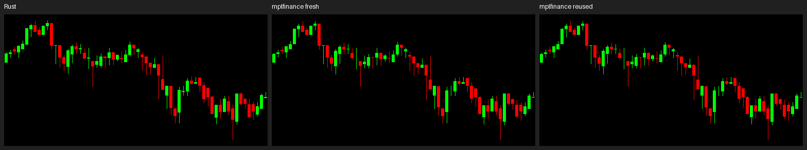

# Candle Maker

Fast candlestick images for Python, rendered by a Rust engine. Designed for
generating batches of model inputs: black backgrounds, green/red candles,
and no axes, labels, grid, or volume. No GPU or plotting framework is needed.

Pass **`(B, N, 4)` OHLC data** and receive **`(B, H, W, 3)` RGB images**.
Each image contains the whole trajectory of its sample, from left to right.
This is a focused raster renderer, not a full mplfinance API replacement.

## Install

Requires **Python 3.10+**, **Rust 1.83+**, and a native compiler/linker.
On Windows, install Visual Studio C++ Build Tools with a Windows SDK.
Windows x64 / CPython 3.12 has been tested; Linux and macOS are not yet verified.

```sh
git clone https://github.com/spractical-ai/candle-maker.git
cd candle-maker
python -m venv .venv
```

Activate the environment with `.\.venv\Scripts\Activate.ps1` on Windows
PowerShell, or `source .venv/bin/activate` on Linux/macOS. Then:

```sh
python -m pip install .
```

This compiles the Rust extension in release mode and installs NumPy automatically.
From another Python project, use `python -m pip install /path/to/candle-maker`.
The distribution name is `candle-maker`; the Python import is `candle_maker`.

To distribute without requiring Rust on the receiving machine, install the
development extras and run `maturin build --release --locked`. Install the
resulting wheel from `target/wheels/` on a matching Python version, OS, and CPU
architecture with `python -m pip install path/to/package.whl`.

## Use

```python
import numpy as np
from candle_maker import render, render_into

# Two samples, three candles each. Columns: open, high, low, close.
ohlc = np.array([
    [[10, 14, 9, 13], [13, 15, 10, 11], [11, 16, 10, 15]],
    [[20, 23, 18, 19], [19, 24, 17, 22], [22, 25, 20, 21]],
], dtype=np.float64)

images = render(ohlc, height=256, width=512)
assert images.shape == (2, 256, 512, 3)
assert images.dtype == np.uint8

# For repeated batches with fixed B/H/W, allocate once.
out = np.empty((2, 256, 512, 3), dtype=np.uint8)
render_into(ohlc, out)  # Returns this same array; H/W come from out.
# Consume out before calling render_into(next_batch, out).
```

Input may be numeric array-like data; a single `(N, 4)` sample also works.
Use contiguous `float64` input to avoid conversion overhead. Output is always
C-contiguous RGB: black `(0, 0, 0)`, green `(0, 255, 0)` for `close >= open`,
and red `(255, 0, 0)` otherwise. Each sample scales independently using its
lowest low and highest high, with approximately 5% vertical padding.

Values must be finite and satisfy `low <= open/close <= high`. At least one
candle and positive image dimensions are required; empty batches are supported.
When there are more candles than image columns, candles can overlap.

`render()` returns independent storage. `render_into()` clears and overwrites
its writable, C-contiguous `uint8` output on every call; consume or copy the
previous images first. Invalid OHLC leaves that buffer unchanged. Input/output
must not overlap or be accessed concurrently during rendering. Output memory
is `B * H * W * 3` bytes, so split large jobs into batches.

To save a preview, install Pillow and use
`Image.fromarray(images[0]).save("chart.png")` after `from PIL import Image`.

## Similar charts, faster generation

The same 64-candle BTC trajectory, rendered at **256 x 512 (H x W)**:



Left: candle-maker. Center: mplfinance with fresh figures. Right: mplfinance
with a reused figure/canvas. Appearance is closely matched; the renderers
are **not pixel-identical**.

Measured throughput in **images/second**, batch size 256, median of five rounds:

| Image H x W | Output mode | mplfinance | candle-maker | Speedup |
| --- | --- | ---: | ---: | ---: |
| 128 x 128 | Fresh | 58 | 121,156 | 2,091x |
| 128 x 128 | Reused | 179 | 384,691 | 2,146x |
| 256 x 512 | Fresh | 56 | 21,323 | 380x |
| 256 x 512 | Reused | 164 | 39,090 | 239x |

Measured on an Intel Core i7-1165G7, Windows 11, Python 3.12.3; 256 distinct
windows of 64 candles, matched colors/dimensions/padding, antialiasing disabled.
Both engines produce actual contiguous RGB batches. Reused modes preallocate
output; mplfinance also retains its figure, axes, and canvas. Rust uses Rayon
workers; mplfinance runs in one process. A separate single-worker Rust control
still measured about **193x** faster at 256 x 512 with reused output.

These numbers describe this OHLC-to-RGB pipeline, not general Rust/Python
performance or training speed. Imports, data preparation, PNG encoding, and
disk I/O are excluded. Hardware, resolution, and batch size affect throughput.
See [benchmark details, versions, and raw timings](docs/benchmarks/README.md).

## Where the speed comes from

- **Direct rasterization:** Rust draws bodies and wicks into RGB memory,
  avoiding general plotting objects, axes layout, and an RGBA-to-RGB copy.
- **Batching and parallelism:** one Python call handles many samples; Rayon
  distributes larger batches across CPU workers.
- **Less memory work:** `render()` transfers its pixel allocation to NumPy
  without another pixel copy. `render_into()` reuses storage between batches.
- **Cached geometry and release builds:** candle positions are cached per
  calling thread for up to 4,096 candles; thin LTO optimizes the native code.

`render()` snapshots input and releases the Python GIL while Rust works.
`render_into()` retains the GIL while borrowing caller-owned memory; its Rust
workers still draw in parallel. Reusing memory accelerates image generation;
the effect on training depends on the rest of your pipeline.

## Develop and benchmark

Inside the activated environment, with Rust available:

```sh
python -m pip install ".[dev]"
maturin develop --release --locked
python -m pytest
cargo test --locked
python examples/benchmark.py
```

For the mplfinance comparison:

```sh
python -m pip install ".[benchmark]"
python examples/benchmark_mplfinance.py --csv path/to/prices.csv
```

The comparison CSV needs a header, then timestamp/open/high/low/close as its
first five columns. Results and visual previews go to ignored `output/`.
Use `--rayon-threads 1 --engines rust rust_reuse` for the single-worker control.
`examples/benchmark_batch_sizes.py` sweeps batch sizes and supports `--reuse-output`.
`examples/render_csv.py path/to/prices.csv` saves PNG previews (requires lowercase
`open`, `high`, `low`, `close` column names and Pillow).

Datasets in `sample_data/`, build products, and local toolchains are intentionally
ignored. Supply your own CSV; the basic usage example and synthetic benchmark
need no dataset. `scripts/use-local-rust.ps1` is an optional helper for a toolchain
already installed in `.tools/`; normal Rust installations do not need it.
